# Architecture map (generated)

Dihasilkan oleh `tool/build_knowledge_graph.py`. Jangan mengedit manual; jalankan ulang script setelah kode berubah.

**64 file · 31,470 baris · 130 class · 253 edge**

## 1. Berkas

| Berkas | Baris | KB | Class | Method | State refs | Dialog |
|---|---:|---:|---:|---:|---:|---:|
| `lib/features/schedule/schedule_page.dart` | 3,726 | 144 | 5 | 53 | 66 | 14 |
| `lib/features/home/home_page.dart` | 2,981 | 108 | 3 | 51 | 64 | 7 |
| `lib/features/preparation/preparation_page.dart` | 2,691 | 97 | 7 | 54 | 70 | 5 |
| `lib/features/family/family_settings_page.dart` | 2,559 | 89 | 2 | 21 | 55 | 25 |
| `lib/features/homework/homework_page.dart` | 2,203 | 87 | 3 | 38 | 41 | 3 |
| `lib/data/store.dart` | 1,986 | 65 | 3 | 60 | 15 | 1 |
| `lib/features/settings/settings_page.dart` | 1,576 | 52 | 4 | 23 | 32 | 7 |
| `lib/supabase_debug_page.dart` | 858 | 17 | 2 | 10 | 0 | 0 |
| `lib/features/schedule/forms/extracurricular_activity_form.dart` | 827 | 27 | 2 | 19 | 1 | 3 |
| `lib/features/schedule/forms/lesson_activity_form.dart` | 825 | 27 | 2 | 19 | 1 | 3 |
| `lib/features/schedule/forms/school_activity_form.dart` | 746 | 24 | 2 | 19 | 1 | 2 |
| `lib/services/bagi_family_service.dart` | 663 | 18 | 1 | 4 | 0 | 0 |
| `lib/features/settings/local_account_page.dart` | 648 | 22 | 2 | 9 | 17 | 6 |
| `lib/family_waiting_room_page.dart` | 570 | 19 | 3 | 6 | 0 | 0 |
| `lib/main.dart` | 563 | 19 | 5 | 9 | 0 | 1 |
| `lib/login_page.dart` | 522 | 19 | 2 | 5 | 0 | 4 |
| `lib/widgets/bagi_tutorial_overlay.dart` | 465 | 15 | 2 | 5 | 0 | 0 |
| `lib/models/activity_models.dart` | 462 | 11 | 10 | 23 | 0 | 0 |
| `lib/signup_page.dart` | 416 | 14 | 2 | 5 | 0 | 1 |
| `lib/services/bagi_auth_service.dart` | 413 | 14 | 2 | 11 | 0 | 0 |
| `lib/widgets/month_calendar.dart` | 368 | 12 | 4 | 10 | 3 | 0 |
| `lib/create_family_page.dart` | 367 | 13 | 2 | 6 | 3 | 2 |
| `lib/features/schedule/forms/exam_activity_form.dart` | 311 | 9 | 2 | 9 | 0 | 0 |
| `lib/auth_gate.dart` | 310 | 8 | 2 | 5 | 8 | 3 |
| `lib/features/schedule/forms/event_activity_form.dart` | 297 | 9 | 2 | 9 | 0 | 0 |
| `lib/features/family/family_activity_page.dart` | 282 | 10 | 2 | 5 | 5 | 0 |
| `lib/bagi_identity_settings_page.dart` | 255 | 7 | 2 | 8 | 0 | 0 |
| `lib/models/family_models.dart` | 243 | 6 | 7 | 12 | 0 | 0 |
| `lib/choose_family_page.dart` | 232 | 7 | 2 | 4 | 0 | 0 |
| `lib/reset_password_page.dart` | 230 | 7 | 2 | 4 | 0 | 1 |
| `lib/widgets/list_items.dart` | 228 | 6 | 4 | 8 | 0 | 0 |
| `lib/family_request_pending_page.dart` | 198 | 7 | 1 | 2 | 0 | 0 |
| `lib/services/bagi_identity_controller.dart` | 198 | 5 | 1 | 9 | 0 | 0 |
| `lib/services/reminder_content.dart` | 190 | 6 | 0 | 0 | 0 | 0 |
| `lib/services/reminder_service.dart` | 189 | 6 | 1 | 10 | 0 | 0 |
| `lib/data/serializers.dart` | 174 | 6 | 0 | 0 | 0 | 0 |
| `lib/features/schedule/widgets/conflict_card.dart` | 151 | 5 | 1 | 2 | 0 | 0 |
| `lib/widgets/bagi_character.dart` | 147 | 4 | 3 | 8 | 0 | 0 |
| `lib/features/homework/homework_history_page.dart` | 114 | 4 | 1 | 2 | 1 | 0 |
| `lib/widgets/app_notification.dart` | 102 | 3 | 0 | 0 | 0 | 0 |
| `lib/services/bagi_profile_service.dart` | 99 | 2 | 2 | 4 | 0 | 0 |
| `lib/services/preparation_defaults.dart` | 93 | 3 | 1 | 2 | 0 | 0 |
| `lib/services/family_access_defaults.dart` | 87 | 2 | 1 | 4 | 0 | 0 |
| `lib/widgets/bubble_tail_painters.dart` | 79 | 2 | 4 | 8 | 0 | 0 |
| `lib/services/bagi_greeting_service.dart` | 77 | 2 | 1 | 7 | 0 | 0 |
| `lib/child_permission_service.dart` | 74 | 2 | 2 | 2 | 0 | 0 |
| `lib/config/supabase_config.dart` | 73 | 2 | 1 | 0 | 0 | 0 |
| `lib/services/bagi_local_auth_service.dart` | 60 | 1 | 1 | 2 | 0 | 0 |
| `lib/services/bagi_session_bridge.dart` | 59 | 1 | 1 | 2 | 0 | 0 |
| `lib/services/bagi_message.dart` | 56 | 2 | 0 | 0 | 0 | 0 |
| `lib/services/bagi_avatar_service.dart` | 51 | 1 | 1 | 4 | 0 | 0 |
| `lib/services/bagi_identity_bootstrap.dart` | 46 | 1 | 1 | 3 | 0 | 0 |
| `lib/Widget/child_avatar.dart` | 46 | 1 | 1 | 2 | 0 | 0 |
| `lib/widgets/child_avatar.dart` | 46 | 1 | 1 | 2 | 0 | 0 |
| `lib/services/owner_tutorial_state.dart` | 38 | 1 | 1 | 6 | 0 | 0 |
| `lib/theme/bag2school_tokens.dart` | 36 | 1 | 3 | 0 | 0 | 0 |
| `lib/services/supabase_auth_test.dart` | 33 | 1 | 1 | 2 | 0 | 0 |
| `lib/models/child_profile.dart` | 32 | 1 | 1 | 2 | 0 | 0 |
| `lib/supabase_service.dart` | 27 | 1 | 1 | 2 | 0 | 0 |
| `lib/supabase_debug_main.dart` | 22 | 0 | 0 | 0 | 0 | 0 |
| `lib/services/supabase_connection_test.dart` | 19 | 0 | 1 | 1 | 0 | 0 |
| `lib/utils/controllers.dart` | 12 | 0 | 0 | 0 | 0 | 0 |
| `lib/services/bagi_app_bootstrap.dart` | 10 | 0 | 1 | 1 | 0 | 0 |
| `lib/utils/focus.dart` | 9 | 0 | 0 | 0 | 0 | 0 |

## 2. Class terbesar

| Class | Berkas | Baris | Method | State refs |
|---|---|---:|---:|---:|
| `_SchedulePageState` | `schedule_page.dart` | 3280 | 48 | 66 |
| `_HomePageState` | `home_page.dart` | 2922 | 48 | 64 |
| `_FamilySettingsPageState` | `family_settings_page.dart` | 2526 | 20 | 55 |
| `_HomeworkPageState` | `homework_page.dart` | 2153 | 36 | 41 |
| `_PreparationPageState` | `preparation_page.dart` | 1916 | 36 | 70 |
| `Bag2SchoolStore` | `store.dart` | 1572 | 49 | 0 |
| `_SettingsPageState` | `settings_page.dart` | 1367 | 16 | 32 |
| `_SupabaseDebugPageState` | `supabase_debug_page.dart` | 847 | 9 | 0 |
| `_ExtracurricularActivityFormState` | `extracurricular_activity_form.dart` | 800 | 18 | 1 |
| `_LessonActivityFormState` | `lesson_activity_form.dart` | 799 | 18 | 1 |
| `_SchoolActivityFormState` | `school_activity_form.dart` | 722 | 18 | 1 |
| `BagiFamilyService` | `bagi_family_service.dart` | 659 | 4 | 0 |
| `_LocalAccountPageState` | `local_account_page.dart` | 627 | 8 | 17 |
| `PreparationOfferCardState` | `preparation_page.dart` | 504 | 13 | 0 |
| `_LoginPageState` | `login_page.dart` | 503 | 4 | 0 |
| `_SignUpPageState` | `signup_page.dart` | 402 | 4 | 0 |
| `BagiAuthService` | `bagi_auth_service.dart` | 379 | 10 | 0 |
| `_CreateFamilyPageState` | `create_family_page.dart` | 343 | 5 | 3 |
| `_Bag2SchoolMonthCalendarState` | `month_calendar.dart` | 303 | 5 | 3 |
| `LocalAuthorization` | `store.dart` | 295 | 9 | 15 |

## 3. Import antar berkas

```mermaid
flowchart LR
  lib_auth_gate_dart["lib/auth_gate.dart"]
  lib_bagi_identity_settings_page_dart["lib/bagi_identity_settings_page.dart"]
  lib_choose_family_page_dart["lib/choose_family_page.dart"]
  lib_config_supabase_config_dart["lib/config/supabase_config.dart"]
  lib_create_family_page_dart["lib/create_family_page.dart"]
  lib_data_serializers_dart["lib/data/serializers.dart"]
  lib_data_store_dart["lib/data/store.dart"]
  lib_family_waiting_room_page_dart["lib/family_waiting_room_page.dart"]
  lib_features_family_family_activity_page_dart["lib/features/family/family_activity_page.dart"]
  lib_features_family_family_settings_page_dart["lib/features/family/family_settings_page.dart"]
  lib_features_home_home_page_dart["lib/features/home/home_page.dart"]
  lib_features_homework_homework_history_page_dart["lib/features/homework/homework_history_page.dart"]
  lib_features_homework_homework_page_dart["lib/features/homework/homework_page.dart"]
  lib_features_preparation_preparation_page_dart["lib/features/preparation/preparation_page.dart"]
  lib_features_schedule_forms_event_activity_form_dart["lib/features/schedule/forms/event_activity_form.dart"]
  lib_features_schedule_forms_exam_activity_form_dart["lib/features/schedule/forms/exam_activity_form.dart"]
  lib_features_schedule_forms_extracurricular_activity_form_dart["lib/features/schedule/forms/extracurricular_activity_form.dart"]
  lib_features_schedule_forms_lesson_activity_form_dart["lib/features/schedule/forms/lesson_activity_form.dart"]
  lib_features_schedule_forms_school_activity_form_dart["lib/features/schedule/forms/school_activity_form.dart"]
  lib_features_schedule_schedule_page_dart["lib/features/schedule/schedule_page.dart"]
  lib_features_schedule_widgets_conflict_card_dart["lib/features/schedule/widgets/conflict_card.dart"]
  lib_features_settings_local_account_page_dart["lib/features/settings/local_account_page.dart"]
  lib_features_settings_settings_page_dart["lib/features/settings/settings_page.dart"]
  lib_login_page_dart["lib/login_page.dart"]
  lib_main_dart["lib/main.dart"]
  lib_models_activity_models_dart["lib/models/activity_models.dart"]
  lib_models_child_profile_dart["lib/models/child_profile.dart"]
  lib_models_family_models_dart["lib/models/family_models.dart"]
  lib_reset_password_page_dart["lib/reset_password_page.dart"]
  lib_services_bagi_app_bootstrap_dart["lib/services/bagi_app_bootstrap.dart"]
  lib_services_bagi_auth_service_dart["lib/services/bagi_auth_service.dart"]
  lib_services_bagi_family_service_dart["lib/services/bagi_family_service.dart"]
  lib_services_bagi_greeting_service_dart["lib/services/bagi_greeting_service.dart"]
  lib_services_bagi_identity_controller_dart["lib/services/bagi_identity_controller.dart"]
  lib_services_bagi_local_auth_service_dart["lib/services/bagi_local_auth_service.dart"]
  lib_services_bagi_message_dart["lib/services/bagi_message.dart"]
  lib_services_bagi_profile_service_dart["lib/services/bagi_profile_service.dart"]
  lib_services_family_access_defaults_dart["lib/services/family_access_defaults.dart"]
  lib_services_owner_tutorial_state_dart["lib/services/owner_tutorial_state.dart"]
  lib_services_preparation_defaults_dart["lib/services/preparation_defaults.dart"]
  lib_services_reminder_content_dart["lib/services/reminder_content.dart"]
  lib_services_reminder_service_dart["lib/services/reminder_service.dart"]
  lib_signup_page_dart["lib/signup_page.dart"]
  lib_supabase_debug_main_dart["lib/supabase_debug_main.dart"]
  lib_supabase_debug_page_dart["lib/supabase_debug_page.dart"]
  lib_theme_bag2school_tokens_dart["lib/theme/bag2school_tokens.dart"]
  lib_utils_controllers_dart["lib/utils/controllers.dart"]
  lib_utils_focus_dart["lib/utils/focus.dart"]
  lib_widgets_app_notification_dart["lib/widgets/app_notification.dart"]
  lib_widgets_bagi_character_dart["lib/widgets/bagi_character.dart"]
  lib_widgets_bagi_tutorial_overlay_dart["lib/widgets/bagi_tutorial_overlay.dart"]
  lib_widgets_bubble_tail_painters_dart["lib/widgets/bubble_tail_painters.dart"]
  lib_widgets_child_avatar_dart["lib/widgets/child_avatar.dart"]
  lib_widgets_list_items_dart["lib/widgets/list_items.dart"]
  lib_widgets_month_calendar_dart["lib/widgets/month_calendar.dart"]
  lib_auth_gate_dart --> lib_choose_family_page_dart
  lib_auth_gate_dart --> lib_data_store_dart
  lib_auth_gate_dart --> lib_family_waiting_room_page_dart
  lib_auth_gate_dart --> lib_login_page_dart
  lib_auth_gate_dart --> lib_services_bagi_family_service_dart
  lib_bagi_identity_settings_page_dart --> lib_services_bagi_identity_controller_dart
  lib_choose_family_page_dart --> lib_create_family_page_dart
  lib_choose_family_page_dart --> lib_family_waiting_room_page_dart
  lib_choose_family_page_dart --> lib_login_page_dart
  lib_create_family_page_dart --> lib_data_store_dart
  lib_create_family_page_dart --> lib_login_page_dart
  lib_create_family_page_dart --> lib_services_bagi_family_service_dart
  lib_create_family_page_dart --> lib_services_bagi_profile_service_dart
  lib_create_family_page_dart --> lib_services_owner_tutorial_state_dart
  lib_data_serializers_dart --> lib_models_activity_models_dart
  lib_data_store_dart --> lib_models_activity_models_dart
  lib_data_store_dart --> lib_models_child_profile_dart
  lib_data_store_dart --> lib_models_family_models_dart
  lib_data_store_dart --> lib_services_bagi_family_service_dart
  lib_data_store_dart --> lib_services_bagi_local_auth_service_dart
  lib_data_store_dart --> lib_services_family_access_defaults_dart
  lib_data_store_dart --> lib_widgets_app_notification_dart
  lib_family_waiting_room_page_dart --> lib_login_page_dart
  lib_family_waiting_room_page_dart --> lib_services_bagi_family_service_dart
  lib_features_family_family_activity_page_dart --> lib_data_store_dart
  lib_features_family_family_activity_page_dart --> lib_models_child_profile_dart
  lib_features_family_family_activity_page_dart --> lib_models_family_models_dart
  lib_features_family_family_settings_page_dart --> lib_create_family_page_dart
  lib_features_family_family_settings_page_dart --> lib_data_store_dart
  lib_features_family_family_settings_page_dart --> lib_models_child_profile_dart
  lib_features_family_family_settings_page_dart --> lib_models_family_models_dart
  lib_features_family_family_settings_page_dart --> lib_services_bagi_family_service_dart
  lib_features_family_family_settings_page_dart --> lib_services_family_access_defaults_dart
  lib_features_family_family_settings_page_dart --> lib_widgets_app_notification_dart
  lib_features_family_family_settings_page_dart --> lib_widgets_bagi_character_dart
  lib_features_family_family_settings_page_dart --> lib_widgets_bagi_tutorial_overlay_dart
  lib_features_home_home_page_dart --> lib_data_store_dart
  lib_features_home_home_page_dart --> lib_features_family_family_activity_page_dart
  lib_features_home_home_page_dart --> lib_features_homework_homework_page_dart
  lib_features_home_home_page_dart --> lib_features_preparation_preparation_page_dart
  lib_features_home_home_page_dart --> lib_features_schedule_schedule_page_dart
  lib_features_home_home_page_dart --> lib_features_settings_settings_page_dart
  lib_features_home_home_page_dart --> lib_models_activity_models_dart
  lib_features_home_home_page_dart --> lib_models_child_profile_dart
  lib_features_home_home_page_dart --> lib_models_family_models_dart
  lib_features_home_home_page_dart --> lib_services_bagi_greeting_service_dart
  lib_features_home_home_page_dart --> lib_services_bagi_message_dart
  lib_features_home_home_page_dart --> lib_services_owner_tutorial_state_dart
  lib_features_home_home_page_dart --> lib_theme_bag2school_tokens_dart
  lib_features_home_home_page_dart --> lib_utils_controllers_dart
  lib_features_home_home_page_dart --> lib_widgets_app_notification_dart
  lib_features_home_home_page_dart --> lib_widgets_bagi_character_dart
  lib_features_home_home_page_dart --> lib_widgets_bagi_tutorial_overlay_dart
  lib_features_home_home_page_dart --> lib_widgets_bubble_tail_painters_dart
  lib_features_home_home_page_dart --> lib_widgets_child_avatar_dart
  lib_features_homework_homework_history_page_dart --> lib_data_store_dart
  lib_features_homework_homework_page_dart --> lib_data_store_dart
  lib_features_homework_homework_page_dart --> lib_features_preparation_preparation_page_dart
  lib_features_homework_homework_page_dart --> lib_features_schedule_schedule_page_dart
  lib_features_homework_homework_page_dart --> lib_features_settings_settings_page_dart
  lib_features_homework_homework_page_dart --> lib_models_activity_models_dart
  lib_features_homework_homework_page_dart --> lib_models_family_models_dart
  lib_features_homework_homework_page_dart --> lib_utils_controllers_dart
  lib_features_homework_homework_page_dart --> lib_utils_focus_dart
  lib_features_homework_homework_page_dart --> lib_widgets_bagi_character_dart
  lib_features_homework_homework_page_dart --> lib_widgets_bagi_tutorial_overlay_dart
  lib_features_homework_homework_page_dart --> lib_widgets_bubble_tail_painters_dart
  lib_features_preparation_preparation_page_dart --> lib_data_store_dart
  lib_features_preparation_preparation_page_dart --> lib_features_homework_homework_page_dart
  lib_features_preparation_preparation_page_dart --> lib_features_schedule_schedule_page_dart
  lib_features_preparation_preparation_page_dart --> lib_features_settings_settings_page_dart
  lib_features_preparation_preparation_page_dart --> lib_models_activity_models_dart
  lib_features_preparation_preparation_page_dart --> lib_models_family_models_dart
  lib_features_preparation_preparation_page_dart --> lib_services_bagi_greeting_service_dart
  lib_features_preparation_preparation_page_dart --> lib_services_bagi_message_dart
  lib_features_preparation_preparation_page_dart --> lib_services_preparation_defaults_dart
  lib_features_preparation_preparation_page_dart --> lib_utils_controllers_dart
  lib_features_preparation_preparation_page_dart --> lib_utils_focus_dart
  lib_features_preparation_preparation_page_dart --> lib_widgets_bagi_character_dart
  lib_features_preparation_preparation_page_dart --> lib_widgets_bagi_tutorial_overlay_dart
  lib_features_preparation_preparation_page_dart --> lib_widgets_bubble_tail_painters_dart
  lib_features_schedule_forms_event_activity_form_dart --> lib_models_activity_models_dart
  lib_features_schedule_forms_event_activity_form_dart --> lib_utils_focus_dart
  lib_features_schedule_forms_exam_activity_form_dart --> lib_models_activity_models_dart
  lib_features_schedule_forms_exam_activity_form_dart --> lib_utils_focus_dart
  lib_features_schedule_forms_extracurricular_activity_form_dart --> lib_data_store_dart
  lib_features_schedule_forms_extracurricular_activity_form_dart --> lib_features_schedule_widgets_conflict_card_dart
  lib_features_schedule_forms_extracurricular_activity_form_dart --> lib_models_activity_models_dart
  lib_features_schedule_forms_extracurricular_activity_form_dart --> lib_services_bagi_message_dart
  lib_features_schedule_forms_extracurricular_activity_form_dart --> lib_utils_focus_dart
  lib_features_schedule_forms_extracurricular_activity_form_dart --> lib_widgets_bagi_character_dart
  lib_features_schedule_forms_lesson_activity_form_dart --> lib_data_store_dart
  lib_features_schedule_forms_lesson_activity_form_dart --> lib_features_schedule_widgets_conflict_card_dart
  lib_features_schedule_forms_lesson_activity_form_dart --> lib_models_activity_models_dart
  lib_features_schedule_forms_lesson_activity_form_dart --> lib_services_bagi_message_dart
  lib_features_schedule_forms_lesson_activity_form_dart --> lib_utils_focus_dart
  lib_features_schedule_forms_lesson_activity_form_dart --> lib_widgets_bagi_character_dart
  lib_features_schedule_forms_school_activity_form_dart --> lib_data_store_dart
  lib_features_schedule_forms_school_activity_form_dart --> lib_features_schedule_widgets_conflict_card_dart
  lib_features_schedule_forms_school_activity_form_dart --> lib_models_activity_models_dart
  lib_features_schedule_forms_school_activity_form_dart --> lib_utils_focus_dart
  lib_features_schedule_schedule_page_dart --> lib_data_store_dart
  lib_features_schedule_schedule_page_dart --> lib_features_homework_homework_page_dart
  lib_features_schedule_schedule_page_dart --> lib_features_preparation_preparation_page_dart
  lib_features_schedule_schedule_page_dart --> lib_features_settings_settings_page_dart
  lib_features_schedule_schedule_page_dart --> lib_models_activity_models_dart
  lib_features_schedule_schedule_page_dart --> lib_models_family_models_dart
  lib_features_schedule_schedule_page_dart --> lib_services_bagi_message_dart
  lib_features_schedule_schedule_page_dart --> lib_theme_bag2school_tokens_dart
  lib_features_schedule_schedule_page_dart --> lib_utils_focus_dart
  lib_features_schedule_schedule_page_dart --> lib_widgets_bagi_character_dart
  lib_features_schedule_schedule_page_dart --> lib_widgets_bagi_tutorial_overlay_dart
  lib_features_schedule_schedule_page_dart --> lib_widgets_bubble_tail_painters_dart
  lib_features_schedule_schedule_page_dart --> lib_widgets_list_items_dart
  lib_features_schedule_schedule_page_dart --> lib_widgets_month_calendar_dart
  lib_features_schedule_widgets_conflict_card_dart --> lib_models_activity_models_dart
  lib_features_schedule_widgets_conflict_card_dart --> lib_services_bagi_message_dart
  lib_features_schedule_widgets_conflict_card_dart --> lib_widgets_bagi_character_dart
  lib_features_settings_local_account_page_dart --> lib_bagi_identity_settings_page_dart
  lib_features_settings_local_account_page_dart --> lib_data_store_dart
  lib_features_settings_local_account_page_dart --> lib_login_page_dart
  lib_features_settings_local_account_page_dart --> lib_models_family_models_dart
  lib_features_settings_local_account_page_dart --> lib_services_bagi_auth_service_dart
  lib_features_settings_local_account_page_dart --> lib_services_bagi_family_service_dart
  lib_features_settings_local_account_page_dart --> lib_utils_controllers_dart
  lib_features_settings_local_account_page_dart --> lib_widgets_app_notification_dart
  lib_features_settings_settings_page_dart --> lib_bagi_identity_settings_page_dart
  lib_features_settings_settings_page_dart --> lib_data_store_dart
  lib_features_settings_settings_page_dart --> lib_features_family_family_activity_page_dart
  lib_features_settings_settings_page_dart --> lib_features_family_family_settings_page_dart
  lib_features_settings_settings_page_dart --> lib_models_child_profile_dart
  lib_features_settings_settings_page_dart --> lib_models_family_models_dart
  lib_features_settings_settings_page_dart --> lib_services_owner_tutorial_state_dart
  lib_features_settings_settings_page_dart --> lib_services_reminder_content_dart
  lib_features_settings_settings_page_dart --> lib_services_reminder_service_dart
  lib_features_settings_settings_page_dart --> lib_utils_controllers_dart
  lib_features_settings_settings_page_dart --> lib_widgets_app_notification_dart
  lib_features_settings_settings_page_dart --> lib_widgets_bagi_tutorial_overlay_dart
  lib_features_settings_settings_page_dart --> lib_widgets_child_avatar_dart
  lib_login_page_dart --> lib_auth_gate_dart
  lib_login_page_dart --> lib_features_home_home_page_dart
  lib_login_page_dart --> lib_services_bagi_auth_service_dart
  lib_login_page_dart --> lib_signup_page_dart
  lib_login_page_dart --> lib_theme_bag2school_tokens_dart
  lib_login_page_dart --> lib_widgets_bagi_character_dart
  lib_main_dart --> lib_auth_gate_dart
  lib_main_dart --> lib_config_supabase_config_dart
  lib_main_dart --> lib_data_store_dart
  lib_main_dart --> lib_features_home_home_page_dart
  lib_main_dart --> lib_reset_password_page_dart
  lib_main_dart --> lib_services_bagi_app_bootstrap_dart
  lib_main_dart --> lib_services_bagi_auth_service_dart
  lib_main_dart --> lib_services_reminder_content_dart
  lib_main_dart --> lib_services_reminder_service_dart
  lib_main_dart --> lib_theme_bag2school_tokens_dart
  lib_reset_password_page_dart --> lib_services_bagi_auth_service_dart
  lib_services_bagi_message_dart --> lib_data_store_dart
  lib_services_bagi_message_dart --> lib_models_family_models_dart
  lib_services_reminder_content_dart --> lib_data_serializers_dart
  lib_services_reminder_content_dart --> lib_data_store_dart
  lib_services_reminder_content_dart --> lib_models_child_profile_dart
  lib_signup_page_dart --> lib_services_bagi_auth_service_dart
  lib_signup_page_dart --> lib_widgets_bagi_character_dart
  lib_supabase_debug_main_dart --> lib_config_supabase_config_dart
  lib_supabase_debug_main_dart --> lib_supabase_debug_page_dart
  lib_widgets_month_calendar_dart --> lib_data_store_dart
  lib_widgets_month_calendar_dart --> lib_models_activity_models_dart
```

## 4. Navigasi (class → halaman)

```mermaid
flowchart TD
  BagiIdentitySettingsPage["BagiIdentitySettingsPage"]
  FamilyActivityPage["FamilyActivityPage"]
  FamilySettingsPage["FamilySettingsPage"]
  HomeworkHistoryPage["HomeworkHistoryPage"]
  HomeworkPage["HomeworkPage"]
  LocalAccountPage["LocalAccountPage"]
  PreparationPage["PreparationPage"]
  SchedulePage["SchedulePage"]
  SettingsPage["SettingsPage"]
  _HomePageState["_HomePageState"]
  _HomeworkPageState["_HomeworkPageState"]
  _LocalAccountPageState["_LocalAccountPageState"]
  _PreparationPageState["_PreparationPageState"]
  _SchedulePageState["_SchedulePageState"]
  _SettingsPageState["_SettingsPageState"]
  _HomePageState --> FamilyActivityPage
  _HomePageState --> HomeworkPage
  _HomePageState --> PreparationPage
  _HomePageState --> SchedulePage
  _HomePageState --> SettingsPage
  _HomeworkPageState --> HomeworkHistoryPage
  _HomeworkPageState --> PreparationPage
  _HomeworkPageState --> SchedulePage
  _HomeworkPageState --> SettingsPage
  _LocalAccountPageState --> BagiIdentitySettingsPage
  _PreparationPageState --> HomeworkPage
  _PreparationPageState --> SchedulePage
  _PreparationPageState --> SettingsPage
  _SchedulePageState --> HomeworkPage
  _SchedulePageState --> PreparationPage
  _SchedulePageState --> SettingsPage
  _SettingsPageState --> BagiIdentitySettingsPage
  _SettingsPageState --> FamilyActivityPage
  _SettingsPageState --> FamilySettingsPage
  _SettingsPageState --> LocalAccountPage
```



## 5. Ketergantungan state global

Semakin besar angkanya, semakin sulit class itu dipindah tanpa refactor.

| Class | State refs | Dialog | Permission check |
|---|---:|---:|---:|
| `_PreparationPageState` | 70 | 5 | 9 |
| `_SchedulePageState` | 66 | 14 | 10 |
| `_HomePageState` | 64 | 7 | 0 |
| `_FamilySettingsPageState` | 55 | 25 | 0 |
| `_HomeworkPageState` | 41 | 3 | 11 |
| `_SettingsPageState` | 32 | 7 | 0 |
| `_LocalAccountPageState` | 17 | 6 | 0 |
| `LocalAuthorization` | 15 | 1 | 0 |
| `_AuthGateState` | 8 | 3 | 0 |
| `_FamilyActivityPageState` | 5 | 0 | 0 |
| `_CreateFamilyPageState` | 3 | 2 | 0 |
| `_Bag2SchoolMonthCalendarState` | 3 | 0 | 0 |
| `_ExtracurricularActivityFormState` | 1 | 3 | 0 |
| `_LessonActivityFormState` | 1 | 3 | 0 |
| `_SchoolActivityFormState` | 1 | 2 | 0 |

## 6. Hotspot dialog

| Class | Dialog / sheet |
|---|---:|
| `_FamilySettingsPageState` | 25 |
| `_SchedulePageState` | 14 |
| `_HomePageState` | 7 |
| `_SettingsPageState` | 7 |
| `_LocalAccountPageState` | 6 |
| `_PreparationPageState` | 5 |
| `_LoginPageState` | 4 |
| `_HomeworkPageState` | 3 |
| `_ExtracurricularActivityFormState` | 3 |
| `_LessonActivityFormState` | 3 |

## 7. Permukaan Supabase

| Tabel / RPC | Dipakai di |
|---|---|
| `child_access_grants` | child_permission_service.dart, supabase_debug_page.dart |
| `children` | bagi_family_service.dart, settings_page.dart, store.dart, supabase_debug_page.dart |
| `families` | bagi_family_service.dart |
| `family_invitation_codes` | bagi_family_service.dart |
| `family_invitations` | bagi_family_service.dart |
| `family_join_requests` | bagi_family_service.dart |
| `family_members` | bagi_family_service.dart, supabase_debug_page.dart |
| `profiles` | bagi_profile_service.dart, supabase_connection_test.dart, supabase_debug_page.dart |
| `rpc:consume_family_invitation_link` | bagi_family_service.dart |
| `rpc:create_family` | bagi_family_service.dart |
| `rpc:create_family_invitation_link` | bagi_family_service.dart |
| `rpc:delete_own_account` | bagi_family_service.dart |
| `rpc:find_profile_by_email` | bagi_family_service.dart |
| `rpc:join_family_with_invitation_code` | bagi_family_service.dart |
| `rpc:leave_family_with_transfer` | bagi_family_service.dart |
| `rpc:validate_family_invitation_code` | bagi_family_service.dart |

