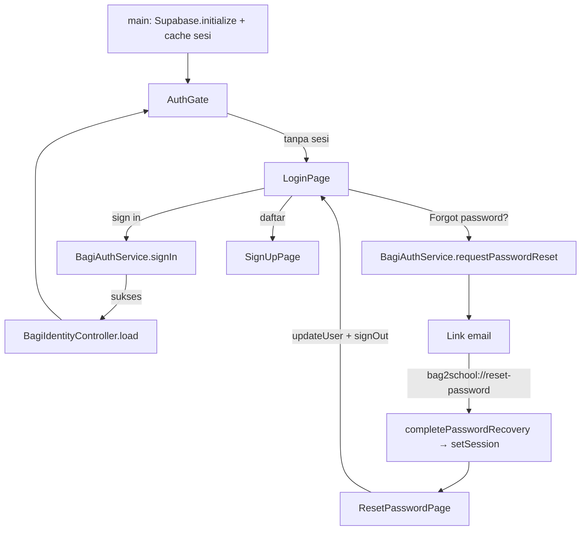
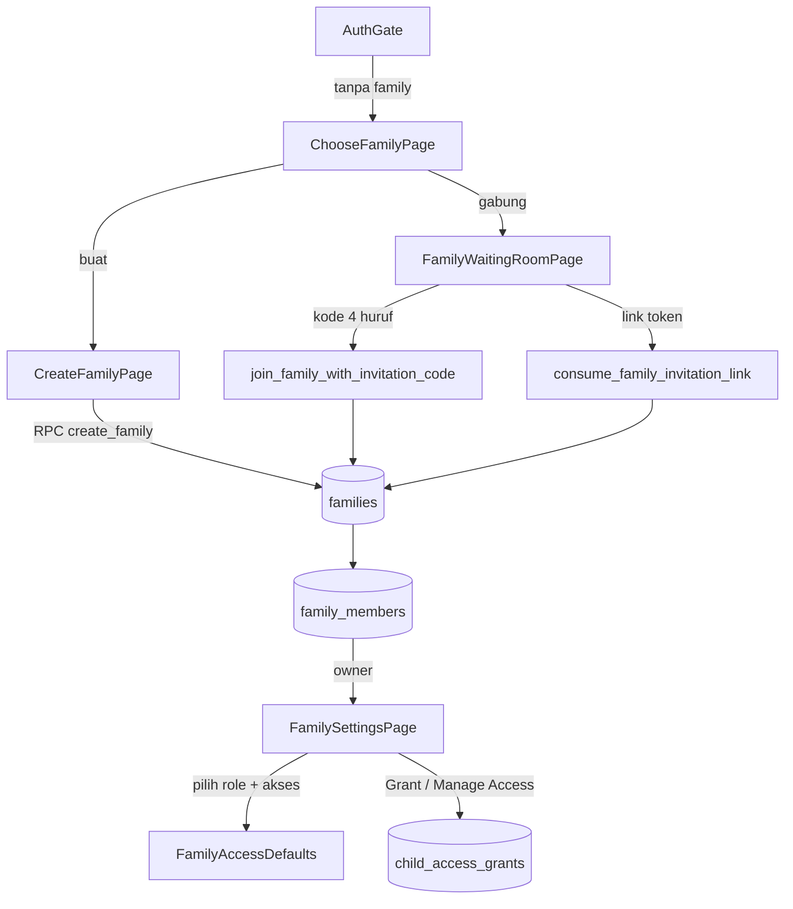
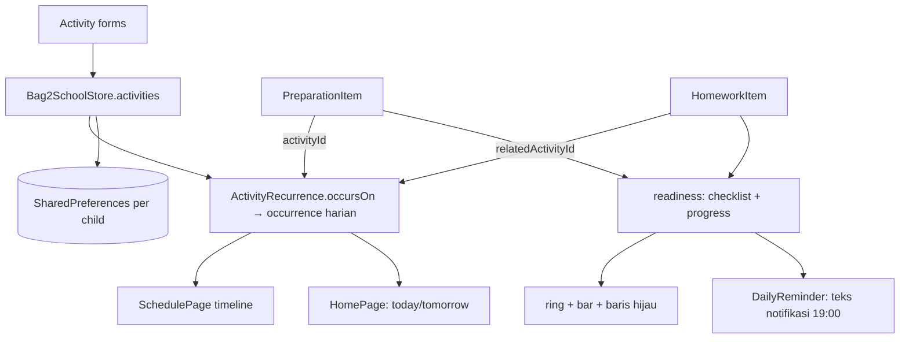

# Bag2School — Knowledge Graph

Peta struktur kode untuk manusia dan AI. Dua lapis:

| Lapis | Berkas | Sumber |
|---|---|---|
| **Otomatis** (selalu akurat) | [generated/architecture-map.md](generated/architecture-map.md) | `tool/build_knowledge_graph.py` |
| **Kurasi** (alur & keputusan) | dokumen ini | ditulis manual, diperbarui saat arsitektur berubah |

Data mentah: [`graph/nodes.json`](../graph/nodes.json) (nodes + edges) dan
[`graph/imports.dot`](../graph/imports.dot) (Graphviz).

## Cara memperbarui

```powershell
python tool/build_knowledge_graph.py
```

Script hanya membaca `lib/`, tidak mengubah kode. Jalankan setiap kali ada
perubahan struktur (class baru, file baru, layar baru).

## Angka kunci (per generate terakhir)

| Metrik | Nilai |
|---|---|
| File Dart | 64 |
| Baris | 31.470 |
| Class | 130 |
| Edge | 253 |
| `main.dart` | 563 baris · 5 class (awal: 76 class / 23.980 baris) |

**Split selesai.** `main.dart` turun dari **77% ke 1,8%** baris kode aplikasi.
Langkah 1–6 seluruhnya sudah dikerjakan (per commit terpisah).

### Layout folder sekarang

```
lib/
├── main.dart             565 baris: boot, MaterialApp, error screen, shell
├── data/                 store.dart, serializers.dart
├── models/               activity_models, family_models, child_profile
├── services/             auth, family, reminder(+content), bagi_message, dll.
├── features/
│   ├── family/           family_activity_page, family_settings_page
│   ├── homework/         homework_page, homework_history_page
│   ├── preparation/      preparation_page (+ checklist item)
│   ├── schedule/         schedule_page (3.726 baris) + forms/ (5 berkas) + widgets/conflict_card
│   ├── settings/         settings_page, local_account_page
│   └── home/             home_page
├── utils/                controllers.dart, focus.dart
├── widgets/              bagi_character, tutorial, month_calendar, list_items,
│                         bubble_tail_painters, app_notification, child_avatar,
│                         daily_reminder_tile
└── theme/                bag2school_tokens.dart
```


## Peta modul

```
lib/
├── main.dart                  → shell aplikasi + 76 class (monolit)
├── auth_gate.dart             → gerbang sesi: Login / ChooseFamily / WaitingRoom / Home
├── login_page.dart            → login + forgot password
├── signup_page.dart           → daftar akun
├── reset_password_page.dart   → set password baru (dari link email)
├── choose_family_page.dart    → belum punya keluarga
├── create_family_page.dart    → buat keluarga
├── family_waiting_room_page.dart  → kode undangan + menunggu approval
├── bagi_identity_settings_page.dart → "Bagi memanggil Anda apa?"
├── supabase_debug_page.dart   → alat debug (bukan bagian alur produksi)
├── config/
│   └── supabase_config.dart   → host per platform + override dart-define
├── models/
│   └── child_profile.dart
├── theme/
│   └── bag2school_tokens.dart → warna, spacing, radius
├── services/                  → 17 service, tanpa UI
│   ├── bagi_auth_service.dart        → sign in/up/out, reset password, deteksi login perangkat lain
│   ├── bagi_family_service.dart      → keluarga, anggota, anak, undangan, RPC
│   ├── bagi_identity_controller.dart → profil & sapaan Bagi
│   ├── bagi_profile_service.dart     → baca/tulis tabel profiles
│   ├── bagi_avatar_service.dart      → upload avatar ke Storage
│   ├── bagi_session_bridge.dart      → sesi → identity
│   ├── bagi_identity_bootstrap.dart
│   ├── bagi_app_bootstrap.dart
│   ├── bagi_greeting_service.dart    → ucapan pagi/siang/malam
│   ├── bagi_local_auth_service.dart  → fallback akun demo (jangan dipakai di produksi)
│   ├── owner_tutorial_state.dart     → flag tutorial di SharedPreferences
│   ├── preparation_defaults.dart     → item persiapan default per tipe
│   ├── family_access_defaults.dart   → akses yang dipilih sebelum undang
│   ├── reminder_service.dart         → notifikasi harian (flutter_local_notifications)
│   ├── supabase_auth_test.dart / supabase_connection_test.dart
│   └── ...
└── widgets/
    ├── bagi_character.dart    → sprite Bagi 3 frame
    ├── bagi_tutorial_overlay.dart → welcome / spotlight / dialog
    └── child_avatar.dart      → avatar anak (gender-aware)
```

## Alur 1 — Autentikasi



Catatan: sejak commit `264c053`, login **tidak** lagi mematikan sesi perangkat
lain; aplikasi menyimpan waktu login perangkat dan memberi tahu sekali bila
ada login lebih baru di perangkat lain.

## Alur 2 — Keluarga & peran



Peran: `owner` (semua hak) · `parent_guardian` · `caregiver` · `child`.
Pemeriksaan izin di klien: `LocalAuthorization.canView / canEdit`.

## Alur 3 — Data jadwal sampai kesiapan



Penyimpanan **masih lokal per perangkat**; Supabase baru dipakai untuk
profil, keluarga, anak, dan undangan.

## Matriks izin

| Fitur | owner | parent_guardian | caregiver | child |
|---|---|---|---|---|
| Schedule lihat/ubah | ✅ / ✅ | sesuai grant | sesuai grant | — |
| Homework lihat/ubah | ✅ / ✅ | sesuai grant | sesuai grant | — |
| Preparation lihat/ubah | ✅ / ✅ | sesuai grant | sesuai grant | — |
| Exam lihat/ubah | ✅ / ✅ | sesuai grant | sesuai grant | — |
| Kelola anggota & akses | ✅ | — | — | — |

`LocalAuthorization._isOwner()` melewati semua pemeriksaan grant.

## Risiko struktural (hasil graph)

1. **`main.dart` 23.980 baris, 76 class** — 4 State class terbesar
   (`_SchedulePageState`, `_HomePageState`, `_FamilySettingsPageState`,
   `_HomeworkPageState`) menyimpan 2.100–3.300 baris masing-masing.
2. **404 referensi `Bag2SchoolStore.`** tersebar di 76 class — state global
   tanpa notifier, sehingga setiap layar memanggil `setState` sendiri.
3. **77 dialog/sheet di `main.dart`** — titik di mana bug context-after-dispose
   mudah muncul (sudah pernah terjadi, lihat commit `26b0ae3`).
4. **Jadwal belum di server** → tidak ada notifikasi perubahan lintas device,
   dan kartu "anak lain" di Home hanya akurat untuk data di HP itu.

## Rencana pemecahan `main.dart` (bertahap, tanpa ubah perilaku)

Urutan dipilih dari yang paling sedikit ketergantungan:

| Langkah | Isi | Keluar ke |
|---|---|---|
| 1 | Model data: `BagActivity`, `PreparationItem`, `HomeworkItem`, `FamilyMember`, `LocalAccount`, `ActivityRecurrence`, dll. | `lib/models/` |
| 2 | Helper murni: `_dayOnly`, `_formatDateLong`, `_formatTime`, serializer JSON | `lib/utils/date.dart`, `lib/data/serializers.dart` |
| 3 | `Bag2SchoolStore` + cache per anak | `lib/data/store.dart` |
| 4 | Widget kecil: `_ActionIconButton`, `BagiTip`, `ScheduleItem`, `TodoItem`, avatar | `lib/widgets/` |
| 5 | Layar per fitur: Schedule (+form), Homework, Preparation, Settings, Family | `lib/features/<fitur>/` |
| 6 | `HomePage` terakhir (paling banyak ketergantungan) | `lib/features/home/` |

Setiap langkah harus: `dart format`, `dart analyze` bersih, `git commit`
terpisah, dan diuji di HP sebelum lanjut.

## Jebakan yang sudah diketahui

- **Jangan** dispose `TextEditingController` langsung setelah route ditutup;
  pakai `_disposeControllersAfterRoute` (commit `26b0ae3`).
- **Jangan** bungkus `Expanded` di dalam `SingleChildScrollView`.
- **Jangan** memakai `Set-Content`/PowerShell untuk menulis file Dart — encoding
  emoji bisa rusak; gunakan tool edit atau `dart format` sesudahnya.
- Sesi multi-device diperbolehkan; jangan kembalikan `signOut(scope: others)`.
